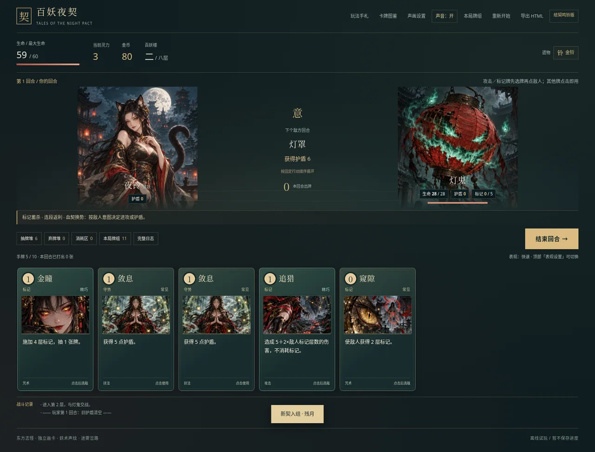
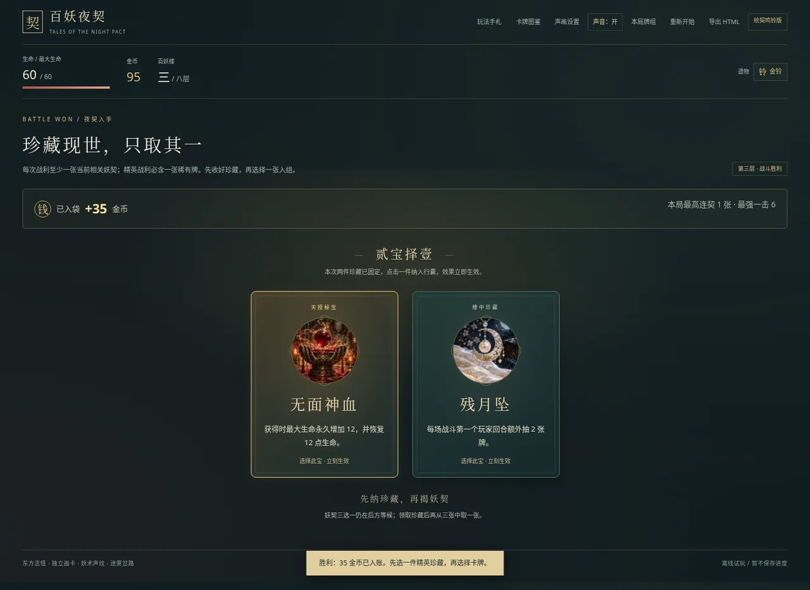
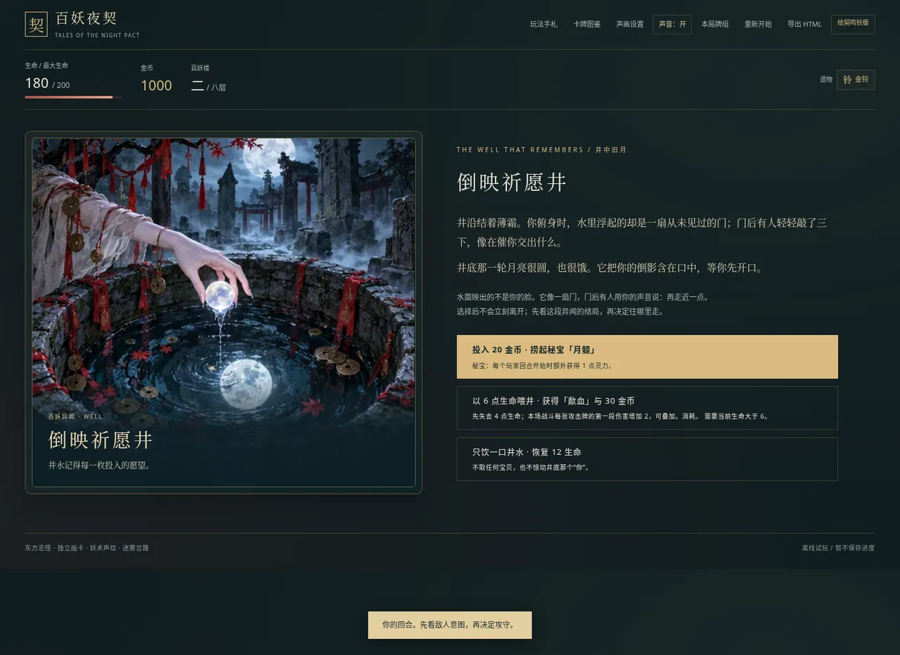

# 百妖夜契 · 绘契鸣铃版

解压试玩包，直接用桌面浏览器打开 `index.html`，保留旁边的 `assets/` 文件夹。想只带一个文件时，打开 `baiyao-standalone.html`：全部图画已内嵌。两种版本均无需安装、服务器或联网。

基于你上传的 `33.zip` 继续制作，保留四列迷雾地图、六段故事和五件秘宝。36 张技能、9 类事件和 13 件遗物均有独立插画；36 种技能音色与命中逐段同步。攻击牌先点牌再点敌人，Esc 取消，结束回合让敌人行动。

精英战会让你挑选珍藏，首次精英保底提供秘宝候选；普通战保底同流派卡、精英保底稀有卡，每局一次免费换牌。揭牌、秘宝入手、连段和收割都有音画反馈，得到的能力会真实生效。声音在首次点击后开启，可在顶部静音或调音量。

从 GitHub 获取成品：

- [下载完整试玩 ZIP](https://github.com/YONGLINGZ/CC/raw/refs/heads/main/recovery/baiyao-rebuilt.zip)，解压后用浏览器打开 `baiyao-rebuilt/index.html`。
- [查看／下载完整单文件 HTML](https://github.com/YONGLINGZ/CC/blob/main/baiyao-standalone.html)，通过文件页的 **Download raw file** 保存到电脑后打开。
- [下载整个源码仓库](https://github.com/YONGLINGZ/CC/archive/refs/heads/main.zip)。

- [完整操作与开发说明](GAME_README.md)
- [本轮实际验证记录](TESTING.md)
- [离线恢复与持久化说明](PERSISTENCE.md)

工作区路径不是聊天附件。「发布环境」也不等于部署网站或发送下载文件。跨新实例的恢复，必须另行实际核验。
