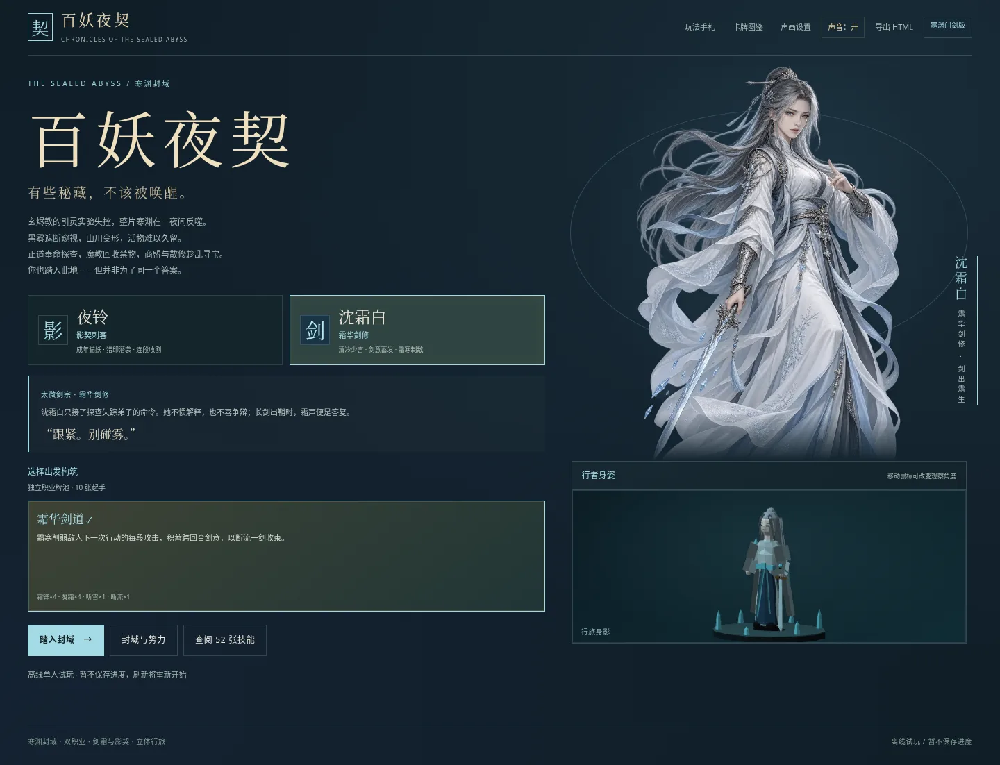
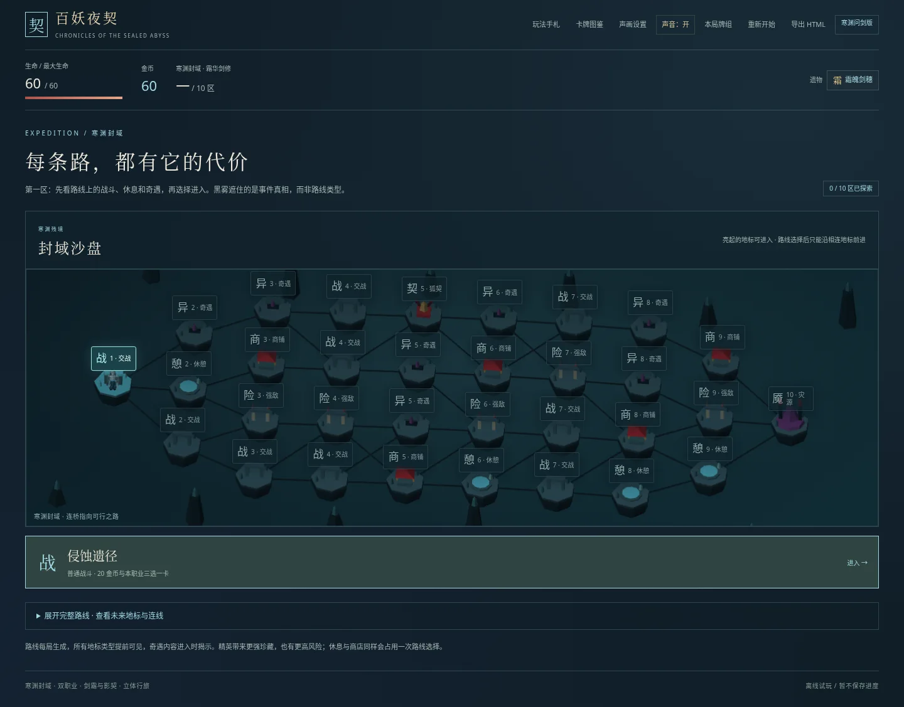

# 百妖夜契 · 寒渊问剑版

魔教玄烬教的“归墟引灵”实验遭到反噬，寒渊整片区域被黑雾封闭。外界无法探查，宗门、魔教残众、商盟与散修只能派人进去。有人找失踪的同门，有人收回证据，有人想把禁术和异宝卖个好价钱。

选择 **夜铃 · 影契刺客** 或 **沈霜白 · 霜华剑修**，沿十段相连的路线深入封域。夜铃通过标记、连击和血契收割；沈霜白清冷寡言，以霜寒削弱敌人的每段攻击，再积攒剑意一剑决胜。两职业使用独立起始牌组、初始遗物、商店和奖励牌池，共 52 种技能。

地图提前显示战斗、精英、奇遇、商店和休息。只能沿当前节点的真实连边前进，选路会失去其他支路。14 种奇遇呈现各方的交易、秘密与损失，代价和收益直接写在选项上；故事只作为探索背景。

## 下载与启动

- [下载完整试玩 ZIP](https://github.com/YONGLINGZ/CC/raw/refs/heads/main/recovery/baiyao-rebuilt.zip)，解压后用桌面浏览器打开 `baiyao-rebuilt/index.html`，保留旁边的 `assets/` 文件夹。
- [查看／下载完整单文件 HTML](https://github.com/YONGLINGZ/CC/blob/main/baiyao-standalone.html)，点击 **Download raw file** 保存后打开，可单独复制。
- [下载整个源码仓库](https://github.com/YONGLINGZ/CC/archive/refs/heads/main.zip)。

两种版本均无需安装、构建、服务器、账号或联网。攻击／施法牌先点牌再点敌人，Esc 取消；结束回合执行已经展示的敌人意图。首次点击启用声音，可在声画设置中静音、调音量或减少动态。刷新重开，暂不存档。

## 场景与人物

路线是实际 WebGL 几何场景：浮岛、断桥、遗迹、营火和事件地标按本局地图生成，人物使用独立的程序化低多边形模型。两位主角保留精细独立原画及正常／50%／25% 三档战损，剑修使用剑芒、冰晶与剑意释放表现，刺客保留潜袭、猫爪和残影。

三维场景和人物是轻量几何模型原型，尚非精细雕刻或完整骨骼角色。夜铃另有自制 2D 网格动态立绘；本版仍没有正式 Cubism Live2D 模型。WebGL 或图片不可用时保留二维地图、SVG 人物和完整游戏操作。

- [完整操作、职业和规则](GAME_README.md)
- [实际运行的检查](TESTING.md)
- [三维模型及动态立绘边界](LIVE2D_STATUS.md)
- [成品与离线恢复说明](PERSISTENCE.md)

工作区路径不是聊天附件，“发布环境”也不等于部署网站或生成下载文件。直接下载仓库成品即可试玩。
